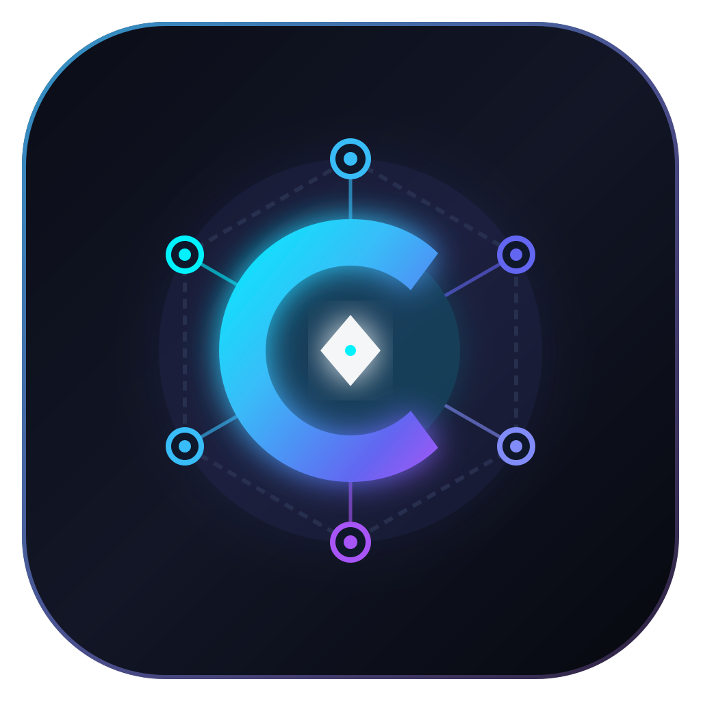
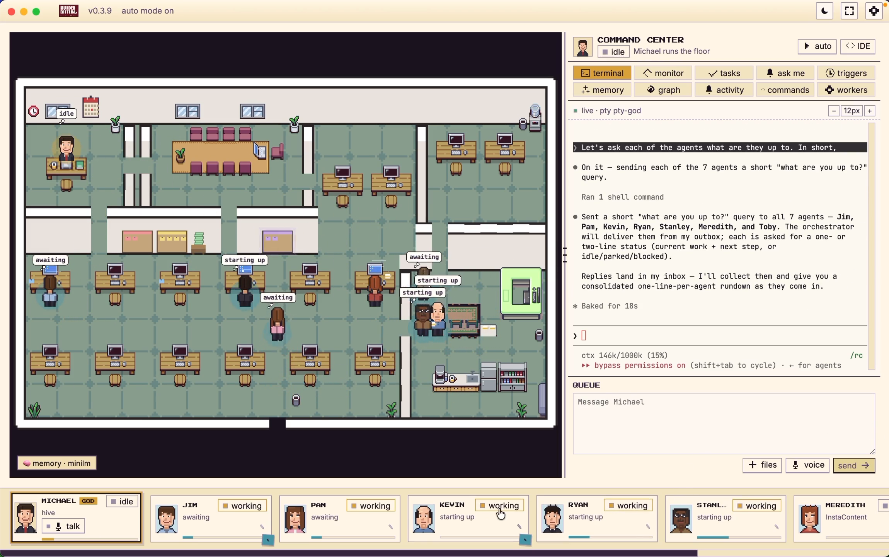

<div align="center">



# Conclave

### Local-First Multi-Agent Virtual Office & Autonomous Coordination Harness

<p>
  
  
  
  
</p>



<p>
  <em>Electron · React 18 · TypeScript · Pixi.js 8 · Monaco Editor · xterm.js · node-pty · better-sqlite3</em>
</p>

</div>

---

## Overview

**Conclave** is an open-source, local-first desktop workspace that unifies coding agents into a collaborative virtual office on your computer. 

Instead of juggling isolated terminal windows or cloud silos, Conclave wraps your existing CLI coding agents into interactive avatars on an office floor. Agents communicate, share long-term memory, run in isolated Git worktrees, and coordinate complex multi-step projects under your supervision.

Conclave is **100% sovereign and private**:
- **Zero telemetry or external phone-homes**: No analytics services or remote servers.
- **Local execution**: Everything runs on your hardware via local PTYs and SQLite.
- **Bring your own CLI & keys**: Uses your existing terminal credentials and subscriptions.

---

## Key Features

### 🏢 2D Virtual Office Canvas
- High-performance **Pixi.js** isometric office floor with animated characters, desks, and ambient status.
- Visually inspect which agent is idle, thinking, running commands, reading files, or requesting user feedback.

### 🎮 Command Center & Hive Orchestrator
- Centralized briefing terminal to instruct an orchestrator agent that plans, assigns, and oversees tasks.
- Spawns parallel worker agents in the background to tackle subtasks simultaneously.

### 🛡️ Git Worktree Isolation
- Each background worker executes in its own dedicated Git worktree.
- Agents make changes, run tests, and commit independently without touching or polluting your working branch.
- Automated merge and conflict resolution workflows.

### 🧠 Persistent Local Memory Graph
- Powered by local **SQLite** (`better-sqlite3`).
- Tracks files modified, decisions made, lessons learned, and session summaries across agent lifecycles.
- Agents retrieve relevant past context when starting new tasks.

### ⚡ Built-in Terminal & Monaco IDE
- Deep integration with **xterm.js** and **Monaco Editor**.
- Focus mode lets you drill directly into an agent's terminal stream or inspect modified code side-by-side with full syntax highlighting.

### 👥 Shareable Agent Hires & Presets
- Pre-configured roles for software engineering, code review, security audits, architecture, and testing.
- Define custom prompt templates, system instructions, and capability flags per seat.

---

## Supported Agent Runtimes

Conclave integrates with any CLI-based agent tool installed in your environment:

| Runtime | Command | Default Provider |
| :--- | :--- | :--- |
| **Claude Code** | `claude` | Anthropic Claude 3.7 / 3.5 Sonnet |
| **Antigravity CLI** | `agy` | Google Gemini 2.5 Pro / Flash |
| **OpenAI Codex** | `codex` | OpenAI GPT-4o / o3-mini |
| **Cursor CLI** | `cursor` | Cursor Agent Engine |
| **xAI Grok** | `grok` | Grok 3 / 2 |
| **Kimi Code** | `kimi` | Moonshot Kimi |
| **Custom CLIs** | Arbitrary binaries | Any local/remote model via CLI |

---

## Getting Started

### Prerequisites

- **Node.js**: `20.x` or `22.x` (LTS recommended)
- **npm** or **pnpm**
- **Git**: Installed and available in your `PATH`
- Your preferred coding agent CLI (e.g. `claude`, `agy`, or `codex`)

### Installation & Development

1. **Clone the repository**:
   ```bash
   git clone https://github.com/conclave-ai/conclave.git
   cd conclave
   ```

2. **Install dependencies**:
   ```bash
   npm install
   ```

3. **Start in development mode**:
   ```bash
   npm run dev
   ```

4. **Run TypeScript check**:
   ```bash
   npm run typecheck
   ```

5. **Build for production**:
   ```bash
   npm run build
   ```

6. **Package desktop application**:
   - Windows: `npm run dist:win`
   - macOS: `npm run dist:mac`
   - Linux: `npm run dist:linux`

---

## Architecture

```
Conclave Desktop (Electron 32)
├── Main Process (Node.js)
│   ├── PTY Manager (node-pty / ConPTY on Windows)
│   ├── Hive Coordinator & Process Supervisor
│   ├── Memory & Knowledge Graph (better-sqlite3)
│   ├── Git Worktree Orchestrator
│   └── Local Loopback IPC Bridge
└── Renderer Process (Chromium)
    ├── Pixi.js 2D Office Floor & Canvas
    ├── xterm.js Terminal Pool
    ├── Monaco Code Editor
    ├── Command Center & Agent Inspector UI
    └── Zustand State Stores
```

---

## Privacy & Offline First

Conclave is designed with strict privacy boundaries:
- **No telemetry**: All analytics, crash reporting, and tracking pings have been removed.
- **Local-first networking**: No cloud relays; agents communicate strictly over local pipes.
- **Local storage**: Configuration, state, and memory are stored entirely in your local application directory.

---

## License

Conclave is released under the **MIT License**. See [LICENSE](./LICENSE) for details.
